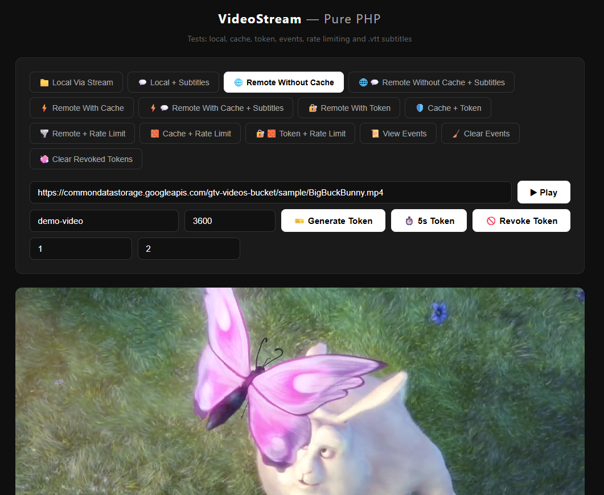

<div align="center">

# 🎬 VideoStream

**PHP video streaming library with HTTP Range support, disk cache, events, temporary tokens, rate limiting, subtitles, and Laravel integration.**

Works standalone (plain PHP) or with Laravel 10/11/12/13+.

[](https://www.php.net/)
[](https://laravel.com/)
[](LICENSE)
[](https://github.com/micilini/video-stream/actions)
[](https://packagist.org/packages/micilini/video-stream)

</div>

---

<p align="center">
  
  <br/><em>Example of usage</em>
</p>


## Features

- **Local streaming** — stream local video files with proper HTTP Range support
- **Remote streaming** — proxy remote video URLs with native Range passthrough
- **Disk cache** — optional file-based cache for remote videos with TTL, LRU eviction, and stale fallback
- **HTTP Range Requests** — seek, scrub, and resume support for HTML5 players
- **Events / hooks** — listen to the streaming lifecycle in plain PHP or Laravel
- **Temporary tokens** — protect streams with signed, expiring tokens
- **Rate limiting** — limit concurrent streams and requests per minute by IP
- **Subtitles** — serve `.vtt` / `.srt` subtitles and associate subtitle tracks with videos
- **Laravel integration** — Service Provider, Facade, publishable config, and Artisan commands
- **Framework agnostic** — works with Laravel, Symfony, Slim, CodeIgniter, or plain PHP
- **Zero required third-party packages in the core** — the main library relies on PHP 8.2+ and `ext-curl`

---

## Installation

```bash
composer require micilini/video-stream
```

### Requirements

- PHP 8.2 or higher
- ext-curl

---

## Quick Start

### Plain PHP

```php
<?php

require 'vendor/autoload.php';

use Micilini\VideoStream\VideoStream;

// Local video
$stream = new VideoStream();
$stream->local('/var/www/videos/movie.mp4')->output();
```

```php
<?php

require 'vendor/autoload.php';

use Micilini\VideoStream\VideoStream;

// Remote video
$stream = new VideoStream();
$stream->remote('https://cdn.example.com/video.mp4')->output();
```

```php
<?php

require 'vendor/autoload.php';

use Micilini\VideoStream\VideoStream;

// Remote video with cache
$stream = new VideoStream();
$stream->remote('https://cdn.example.com/video.mp4')
    ->cache(
        enabled: true,
        ttl: 3600,
        fresh: false,
        path: '/tmp/video-cache',
        maxDisk: 10 * 1024 * 1024 * 1024
    )
    ->output();
```

### Laravel

After installation, the Service Provider and Facade are auto-discovered.

**Publish the config (optional):**

```bash
php artisan vendor:publish --tag=video-stream-config
```

**Routes example:**

```php
use Illuminate\Support\Facades\Route;
use Micilini\VideoStream\Laravel\VideoStreamFacade as VideoStream;

Route::get('/video/{file}', function (string $file) {
    $path = storage_path("app/videos/{$file}");
    return VideoStream::local($path)->stream();
});

Route::get('/stream', function () {
    $url = request('url');

    return VideoStream::remote($url)
        ->cache(enabled: true)
        ->stream();
});
```

### Symfony

```php
use Micilini\VideoStream\VideoStream;
use Symfony\Component\HttpFoundation\Response;

class VideoController
{
    public function play(): Response
    {
        $stream = new VideoStream();
        return $stream->local('/path/to/video.mp4')->stream();
    }
}
```

### Other frameworks

```php
use Micilini\VideoStream\VideoStream;

$stream = new VideoStream();
$stream->local('/path/to/video.mp4')->output();
```

---

## API Overview

### Main class

```php
$stream = new VideoStream(
    defaultBufferSize: 262144,
    defaultContentType: 'video/mp4',
    cacheHandler: null,
);
```

### Fluent methods

| Method | Description |
|--------|-------------|
| `->local(string $path)` | Set a local file as the video source |
| `->remote(string $url)` | Set a remote URL as the video source |
| `->contentType(string $type)` | Override the `Content-Type` header |
| `->buffer(int $bytes)` | Override the buffer size |
| `->cacheControl(string $value)` | Override the `Cache-Control` header |
| `->cache(...)` | Configure disk cache for remote videos |
| `->on(string $event, callable $listener)` | Register an event listener |
| `->withToken(...)` | Validate a signed token before streaming |
| `->rateLimit(...)` | Limit concurrent streams and requests by IP |
| `->subtitle(string $path)` | Output a subtitle file directly |
| `->subtitles(array $tracks)` | Associate subtitle tracks with a video |
| `->output()` | Stream directly via `echo` + `flush` |
| `->stream()` | Return `StreamedResponse` if Symfony is available, otherwise call `output()` |
| `VideoStream::generateToken(...)` | Generate a signed expiring token |

---

## Disk Cache

```php
$stream->remote($url)->cache(
    enabled: true,
    ttl: 86400,
    fresh: false,
    path: '/tmp/video-cache',
    maxDisk: 10_737_418_240,
)->output();
```

For local videos, `->cache()` is ignored.

### Cache behavior

| Scenario | Behavior |
|----------|----------|
| Cache hit, not expired | Serve from disk immediately |
| Cache hit, expired, remote OK | Re-download and replace cache |
| Cache hit, expired, remote down | Serve stale cache |
| Cache miss, remote OK | Download, cache, and serve |
| Cache miss, remote down | Throw `StreamException` |
| Disk full | LRU eviction removes the oldest files |

---

## Events / Hooks

Use events to monitor the stream lifecycle, add custom logging, or feed analytics.

### Plain PHP

```php
use Micilini\VideoStream\VideoStream;

$stream = new VideoStream();

$stream->on('beforeStream', function (array $context) {
    error_log('Starting stream: ' . ($context['source'] ?? 'unknown'));
});

$stream->on('afterStream', function (array $context) {
    error_log('Finished stream');
});

$stream->remote('https://cdn.example.com/video.mp4')->output();
```

### Available events

- `beforeStream`
- `afterStream`
- `onCacheHit`
- `onCacheMiss`
- `onCacheExpired`
- `onError`

### Laravel

In Laravel, you can bridge those hooks to framework events and listeners through the package integration layer.

---

## Temporary Tokens

Use signed tokens to protect streaming URLs.

### Generate a token

```php
use Micilini\VideoStream\VideoStream;

$token = VideoStream::generateToken(
    videoId: 'movie-123',
    secret: 'my-app-secret',
    expiresIn: 3600,
    ip: '192.168.1.100',
);
```

### Validate before streaming

```php
use Micilini\VideoStream\VideoStream;

$stream = new VideoStream();

$stream->remote('https://cdn.example.com/video.mp4')
    ->withToken(
        token: $_GET['token'],
        secret: 'my-app-secret',
        videoId: 'movie-123',
        ip: $_SERVER['REMOTE_ADDR'] ?? null,
    )
    ->output();
```

If the token is invalid or expired, the package throws an exception.

---

## Rate Limiting

Limit the number of simultaneous streams and requests per minute for a given IP.

```php
use Micilini\VideoStream\VideoStream;

$stream = new VideoStream();

$stream->remote('https://cdn.example.com/video.mp4')
    ->rateLimit(
        maxConcurrent: 3,
        maxPerMinute: 30,
        storagePath: '/tmp/video-stream-rate-limit',
        ip: $_SERVER['REMOTE_ADDR'] ?? null,
    )
    ->output();
```

This is useful to reduce abuse and protect server resources without external infrastructure.

---

## Subtitles

### Output a subtitle file directly

```php
use Micilini\VideoStream\VideoStream;

$stream = new VideoStream();
$stream->subtitle('/path/to/subtitles/movie.vtt')->output();
```

### Associate subtitles with a video

```php
use Micilini\VideoStream\VideoStream;

$stream = new VideoStream();

$stream->local('/path/to/video.mp4')
    ->subtitles([
        'pt' => '/subtitles/movie-pt.vtt',
        'en' => '/subtitles/movie-en.vtt',
    ])
    ->output();
```

Supported subtitle scenarios:

- `.vtt` output
- `.srt` support
- `.srt` to `.vtt` conversion when needed
- subtitle metadata association through the video response pipeline

---

## Example Demo

The repository includes a runnable example application under the `example/` directory.

Suggested structure:

```text
example/
├── index.php
├── index.html
├── cache/
├── rate-limit/
├── subtitles/
└── videos/
```

### Notes

- Keep the demo HTML inside `example/`
- Use a relative base path in the frontend, such as:

```js
const PURE_BASE = './index.php';
```

- Open the demo through a local web server, not `file://`
- The demo is useful to validate:
  - local streaming
  - remote streaming
  - cache
  - temporary tokens
  - rate limiting
  - subtitles
  - event logging

---

## Laravel Configuration

After publishing the config:

```bash
php artisan vendor:publish --tag=video-stream-config
```

A typical `config/video-stream.php` may include:

```php
return [
    'buffer_size' => 262144,
    'default_content_type' => 'video/mp4',

    'cache' => [
        'enabled' => env('VIDEO_STREAM_CACHE', false),
        'path' => storage_path('app/video-cache'),
        'ttl' => (int) env('VIDEO_STREAM_CACHE_TTL', 86400),
        'max_disk_usage' => (int) env('VIDEO_STREAM_CACHE_MAX_DISK', 10 * 1024 * 1024 * 1024),
    ],

    'auth' => [
        'secret' => env('VIDEO_STREAM_AUTH_SECRET', ''),
        'default_ttl' => (int) env('VIDEO_STREAM_AUTH_TTL', 3600),
    ],

    'events' => [
        'enabled' => env('VIDEO_STREAM_EVENTS_ENABLED', true),
    ],

    'rate_limit' => [
        'enabled' => env('VIDEO_STREAM_RATE_LIMIT_ENABLED', false),
        'max_concurrent' => (int) env('VIDEO_STREAM_RATE_LIMIT_MAX_CONCURRENT', 3),
        'max_per_minute' => (int) env('VIDEO_STREAM_RATE_LIMIT_MAX_PER_MINUTE', 30),
    ],
];
```

### Example `.env`

```dotenv
VIDEO_STREAM_CACHE=true
VIDEO_STREAM_CACHE_TTL=86400
VIDEO_STREAM_CACHE_MAX_DISK=10737418240

VIDEO_STREAM_AUTH_SECRET=change-this-secret
VIDEO_STREAM_AUTH_TTL=3600

VIDEO_STREAM_EVENTS_ENABLED=true

VIDEO_STREAM_RATE_LIMIT_ENABLED=false
VIDEO_STREAM_RATE_LIMIT_MAX_CONCURRENT=3
VIDEO_STREAM_RATE_LIMIT_MAX_PER_MINUTE=30
```

### Artisan commands

```bash
php artisan video-stream:cache-status
php artisan video-stream:cache-clear
php artisan video-stream:cache-clear --expired
```

---

## Project Structure

```text
src/
├── VideoStream.php
├── Contracts/
│   ├── StreamDriverInterface.php
│   ├── CacheHandlerInterface.php
│   └── EventDispatcherInterface.php
├── Config/
│   └── StreamConfig.php
├── Drivers/
│   ├── LocalStreamDriver.php
│   └── RemoteStreamDriver.php
├── Cache/
│   └── FileCacheHandler.php
├── Http/
│   ├── RangeRequestHandler.php
│   └── RateLimiter.php
├── Auth/
│   ├── TokenGenerator.php
│   └── TokenValidator.php
├── Events/
│   ├── StreamEvent.php
│   ├── BeforeStream.php
│   ├── AfterStream.php
│   ├── CacheHit.php
│   ├── CacheMiss.php
│   ├── CacheExpired.php
│   ├── StreamError.php
│   └── CallbackEventDispatcher.php
├── Subtitles/
│   ├── SubtitleHandler.php
│   └── SrtToVttConverter.php
├── Exceptions/
│   ├── StreamException.php
│   ├── VideoNotFoundException.php
│   ├── InvalidConfigException.php
│   ├── CacheException.php
│   ├── InvalidTokenException.php
│   ├── TokenExpiredException.php
│   └── RateLimitExceededException.php
└── Laravel/
    ├── VideoStreamServiceProvider.php
    ├── VideoStreamFacade.php
    └── Commands/
        ├── CacheClearCommand.php
        └── CacheStatusCommand.php
```

---

## Testing

```bash
composer install
vendor/bin/phpunit
```

The test suite should cover:

- `StreamConfig` validation
- HTTP Range parsing
- local streaming
- remote streaming
- cache TTL / eviction / stale fallback
- event dispatching
- token generation and validation
- rate limiting
- subtitle output and conversion
- integration with the fluent API

---

## Upgrade Notes

If you removed the legacy v1-style API in the new major version, document that change in an `UPGRADE.md` file and keep the README focused on the fluent API only.

---

## Contributing

Pull requests are welcome. For major changes, open an issue first so the scope can be discussed before implementation.

---

## License

[MIT](LICENSE)

---

<div align="center">

Made with ☕ by [Micilini](https://github.com/micilini)

</div>
